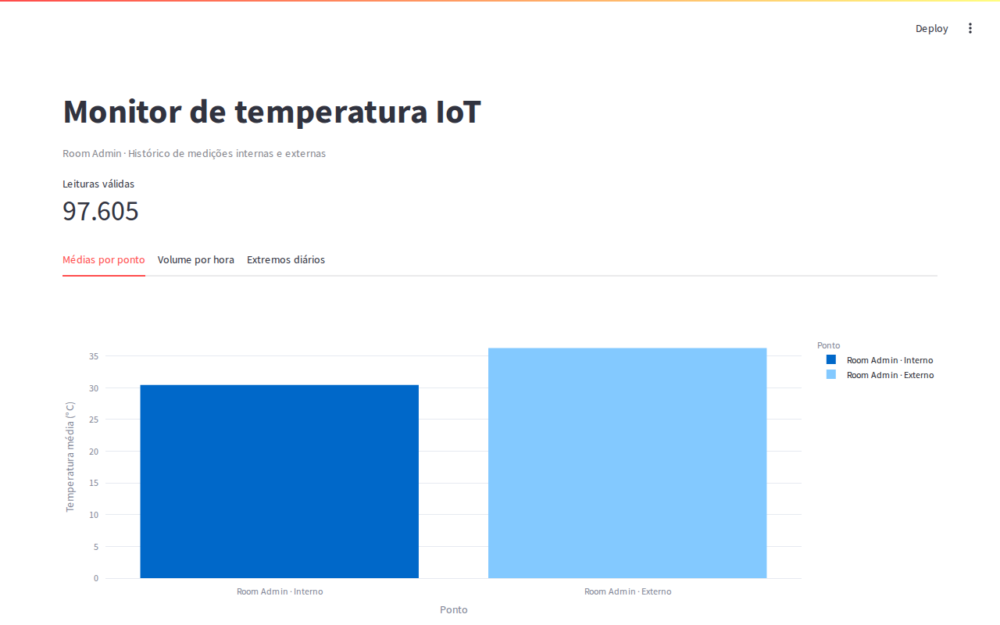
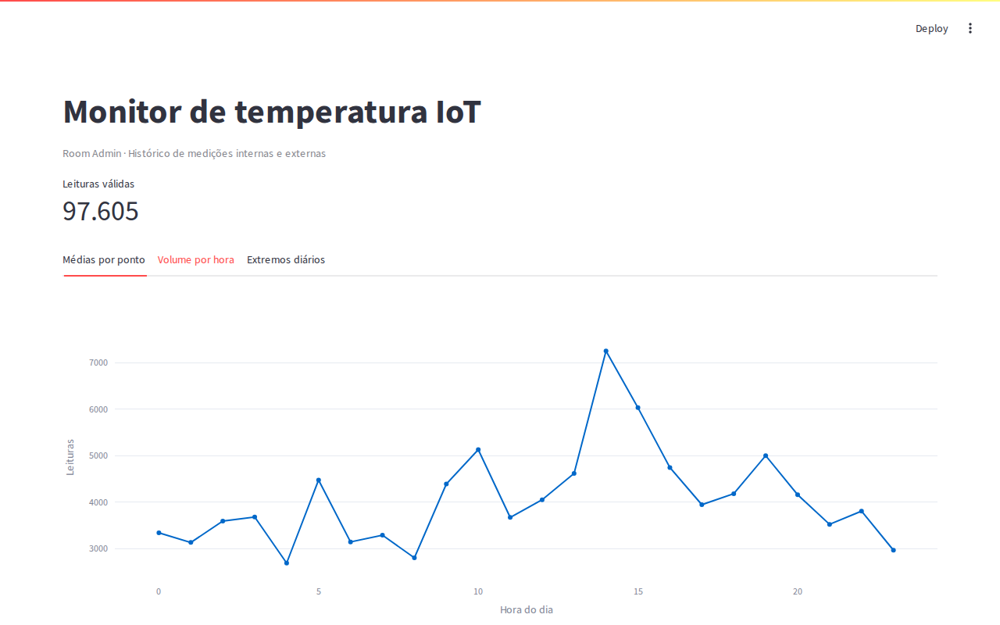
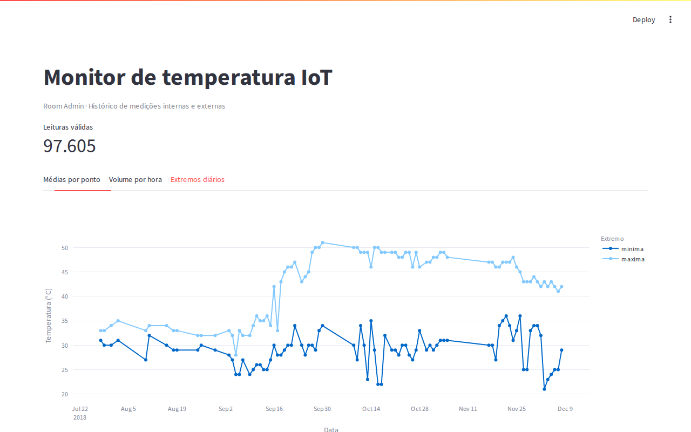

# Pipeline de dados com IoT e Docker

**Diogo Fuentes Pereira · UniFECAF**  
Disruptive Architectures: IoT, Big Data e IA

Como comparar as condições internas e externas de uma sala e identificar horários com pouca coleta? O projeto usa Python e pandas para tratar um CSV, SQLAlchemy e psycopg2 para gravá-lo no PostgreSQL 16 e Streamlit com Plotly para explorar três indicadores. O Compose coordena banco, carga e painel.

## Executar no Windows

1. Instale o Git e o Docker Desktop com suporte a contêineres Linux. Abra o Docker Desktop.
2. Baixe e extraia [Temperature Readings: IoT Devices, de Atulanand Jha](https://www.kaggle.com/datasets/atulanandjha/temperature-readings-iot-devices). Coloque o arquivo original em `data/IOT-temp.csv`. Para conferir a instalação com oito registros reais, copie `data/amostra.csv` para esse nome.
3. Abra o PowerShell na pasta que contém compose.yaml. Crie o arquivo .env e escolha uma senha local no lugar do exemplo.
   
   ```powershell
   'POSTGRES_PASSWORD=troque_por_uma_senha_local' | Set-Content -Encoding ascii .env
   docker compose up --build -d
   docker compose logs carga
   ```
4. Abra http://localhost:8501. Alterne as abas e passe o mouse sobre os pontos para ver os valores. Um arraste amplia o gráfico e um clique duplo restaura a escala.
5. Para conferir o banco, execute:
   
   ```bash
   docker compose exec db psql -U iot -d iot -c "SELECT count(*) FROM temperature_readings"
   docker compose exec db psql -U iot -d iot -c "SELECT * FROM media_por_ponto"
   docker compose exec db psql -U iot -d iot -c "SELECT sum(contagem) FROM leituras_por_hora"
   ```
   O total da tabela e a soma horária devem coincidir com as leituras válidas únicas no log. Na amostra ambos são 8.
6. Após trocar o CSV, use `docker compose run --rm carga` e recarregue o painel. A importação substitui a fotografia anterior em uma transação. Para encerrar e preservar o volume, use `docker compose down`.

## Ambiente virtual opcional

O Compose instala as dependências na imagem Python 3.12. Para trabalhar nos scripts pelo Windows, execute:

```powershell
py -3.12 -m venv .venv
.\.venv\Scripts\python -m pip install -r requirements.txt
```

Para executar fora do Compose, aponte PGHOST, PGPORT, PGDATABASE, PGUSER e PGPASSWORD para um PostgreSQL acessível. Execute `python src/carga.py data/IOT-temp.csv` e `streamlit run src/dashboard.py` no ambiente virtual. O banco do Compose fica na rede interna por padrão.

## Modelagem e consultas

| View | Cálculo | Aplicação |
|---|---|---|
| media_por_ponto | AVG por sala e posição, com COUNT de leituras | Comparar os ambientes e avaliar o tamanho de cada grupo |
| leituras_por_hora | COUNT por hora de 0 a 23, acumulado em todas as datas | Investigar mudanças na frequência da coleta |
| temp_max_min_por_dia | MIN e MAX de cada data registrada | Localizar episódios extremos para investigação |

O campo id identifica a leitura. A combinação de room_id/id e out/in identifica um ponto lógico de medição. A data usa dia-mês-ano e hora local conforme o arquivo. Campos vazios, datas inválidas, posições desconhecidas e temperaturas não finitas são contabilizados como rejeições. Repetições integralmente iguais são removidas. IDs conflitantes interrompem o processamento e preservam a carga anterior.

## Resultados e figuras

A carga processou 97.606 linhas e gravou 97.605 leituras únicas. Uma duplicata integral foi removida. A média interna foi de 30,45 °C e a externa de 36,27 °C. A maior concentração ocorreu às 14h, com 7.248 leituras. Os registros válidos variaram de 21 a 51 °C. A maior amplitude em uma única data foi de 28 °C.





## Relatório, vídeo e reprodução

- [Relatório em PDF](docs/Relatorio-IoT.pdf)
- [Assistir ao pitch no YouTube (1min15s)](https://www.youtube.com/watch?v=q7Z0uRvEoXI)
- [Versão com narração sintética (MP4)](docs/Pitch-IoT.mp4)
- [Roteiro da narração](docs/Roteiro.txt)
- [Execução verificada com Docker e PostgreSQL](https://github.com/cavani530/pipeline-iot-docker/actions/runs/45935931987)

O fluxo em .github/workflows/demonstracao.yml baixa a base, executa a carga duas vezes, abre as três abas do Streamlit e publica as evidências em docs/. Para repetir, use Actions → Executar pipeline e gerar evidências → Run workflow.

## Git e publicação

Na pasta extraída, configure a identidade, registre o projeto e publique em um repositório público vazio. Substitua os campos pelos seus dados.

```bash
git init -b main
git config user.name "Diogo Fuentes Pereira"
git config user.email "SEU_EMAIL_VERIFICADO_OU_NOREPLY"
git add .
git commit -m "Projeto inicial: Pipeline de Dados IoT"
git remote add origin URL_DO_REPOSITORIO
git push -u origin main
git pull --ff-only
```

Para entregar, publique o MP4 final como público ou não listado e confira o vídeo e o repositório em uma janela anônima. Envie o PDF e os dois links.

## Organização

- src/ — transformação, carga e dashboard.
- sql/ — tabela e definições das três views.
- data/ — amostra e destino do CSV completo.
- docs/ — gráficos, relatório, roteiro, vídeo e geradores de evidências.
